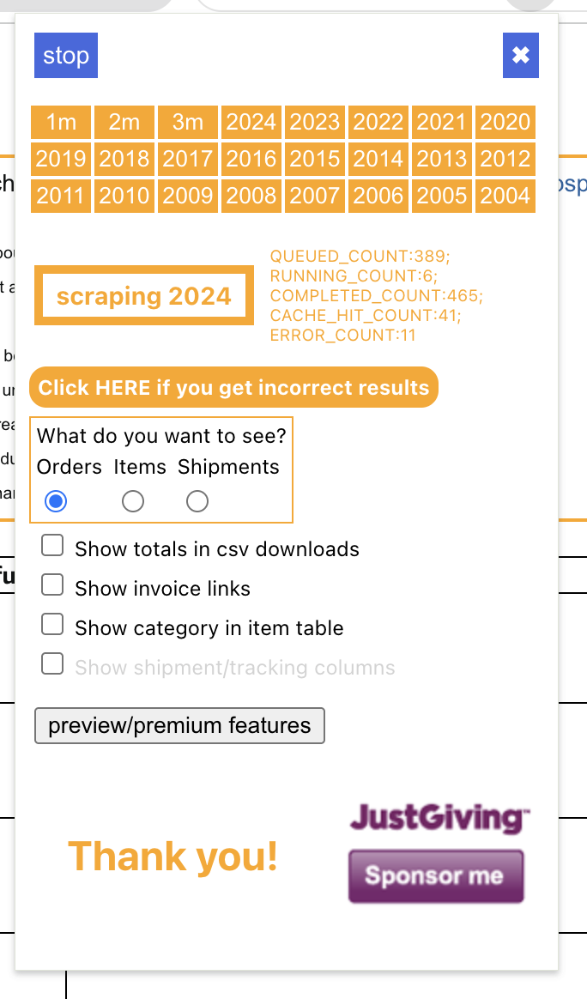

[](https://github.com/iloveitaly/amazon-lunchmoney/releases)
[](https://pepy.tech/project/amazon-lunchmoney)

[](https://opensource.org/licenses/MIT)

# Enhance and Categorize Amazon Transactions in LunchMoney

[LunchMoney](https://mikebian.co/lunchmoney) is a indie-developed personal finance application. I spend a lot on Amazon, and always thought it would be neat to break open the massive black bucket of money that's funneled into Amazon to understand what categories of spending it represents.

The trick is, Amazon doesn't have an order export. [There's a sneaky extension](https://github.com/philipmulcahy/azad) that allows you to export your orders to a CSV file. This tool ingests that CSV and categorizes your Amazon transactions in Lunch Money.

However, in order to match orders to transactions in Lunch Money, you have to match orders not items, which eliminates a clear 1:1
mapping between transaction and category. To solve this, we pipe the list of items to an LLM via Pydantic AI and ask it to categorize the items
based on the categories available in your LunchMoney account.

## Features

- Marked as gift if recipient is not the owner name passed to the CLI
- Support for multiple AI providers via [Pydantic AI](https://ai.pydantic.dev/), with Google Gemini as the default (`google:gemini-3.8-flash`)
- Summary of items purchased and order number is added to the transaction notes.

## Installation

```bash
uv add amazon-lunchmoney
```

> **Note**: OpenAI, Anthropic, and Gemini (Google) are supported by default. To install all providers supported by Pydantic AI, use `pip install "amazon-lunchmoney[all-providers]"`.

Or for local development:

```bash
mise install
just setup
```

## Usage

1. Use the [amazon order scraper](https://github.com/philipmulcahy/azad) to pull your amazon history.
   1. You want order view, not items, so we can match up charges to orders.
2. Get a lunch money API key. Run `cp .env-example .env` and add your API key to `.env`, or input it directly via the command line.
3. Configure your AI provider:

```shell
export AMAZON_LUNCHMONEY_AI_KEY=<YOUR API KEY>
export AMAZON_LUNCHMONEY_MODEL=google:gemini-3.8-flash
```

Or configure provider-specific keys directly (e.g. `GOOGLE_API_KEY`, `OPENAI_API_KEY`, or `ANTHROPIC_API_KEY`).


```shell
Usage: amazon-lunchmoney [OPTIONS]

Options:
  --version                       Show the version and configured model and
                                  exit.
  -v, --verbose                   output verbose logs
  -f, --file FILE                 amazon history file  [required]
  --format [azad|amazon-shopping-mcp]
                                  order history file format  [default: azad]
  -k, --lunch-money-key TEXT      lunch money api key
  -d, --dry-run                   dry run mode
  -n, --owner-names TEXT          name of the owner(s) of the account, used to
                                  determine if a order is a gift
  -c, --default-category TEXT     default category  [required]
  -l, --limit INTEGER RANGE       limit the number of input order transactions
                                  to process  [x>=1]
  -a, --after-date [%Y-%m-%d]     only process transactions on or after this
                                  date (YYYY-MM-DD)
  -h, --help                      Show this message and exit.
```

Two order history formats are supported via `--format`:

- `azad` (default): CSV exported by the [azad extension](https://github.com/philipmulcahy/azad) in order view.
- `amazon-shopping-mcp`: JSONL of `OrderSummary` objects exported by [amazon-shopping-mcp](https://github.com/iloveitaly/amazon-shopping-mcp). This format carries no recipient data, so gift detection is inactive for these orders.

Here's an example command:

```shell
amazon-lunchmoney -f '~/Downloads/amazon_order_history.csv' -c Shopping -n "Michael Bianco"
```

You'll probably want to dry run it first, to setup missing categories.

```shell
amazon-lunchmoney -f '~/Downloads/amazon_order_history.csv' -c Shopping -n "Michael Bianco" -d
```

### OpenAI Costs

The most amazing thing about this approach is it costs effectively nothing.

In order to test the system, I ran this multiple times in dry-run mode against my full-year amazon transactions (~200). It consumed about 200k tokens, which is below the minimum billing threshold for OpenAI, so running this was free. Amazing.

## Development

Update the package and run the tests:

```shell
just test
just lint
```

Or open up a repl and play around:

```python
import os

from amazon_lunchmoney.formats import read_orders
from amazon_lunchmoney.lunchmoney import LunchMoneyClient

client = LunchMoneyClient(token=os.environ["LUNCH_MONEY_API_KEY"])

all_amazon_transactions = read_orders("path/to/amazon_order_history.csv", "azad")
```

You can log loudly as well:

```shell
LOG_LEVEL=debug amazon-lunchmoney -f '~/Downloads/amazon_order_history.csv' -c Shopping -n "Michael Bianco"
```

## TODO

- [ ] Indicate which purchases are HSA/FSA eligible and maybe generate receipt? This would need to be added to the scraper
- [ ] Should match up refunds and categorize them appropriately

---

*This project was created from [iloveitaly/python-package-template](https://github.com/iloveitaly/python-package-template)*
